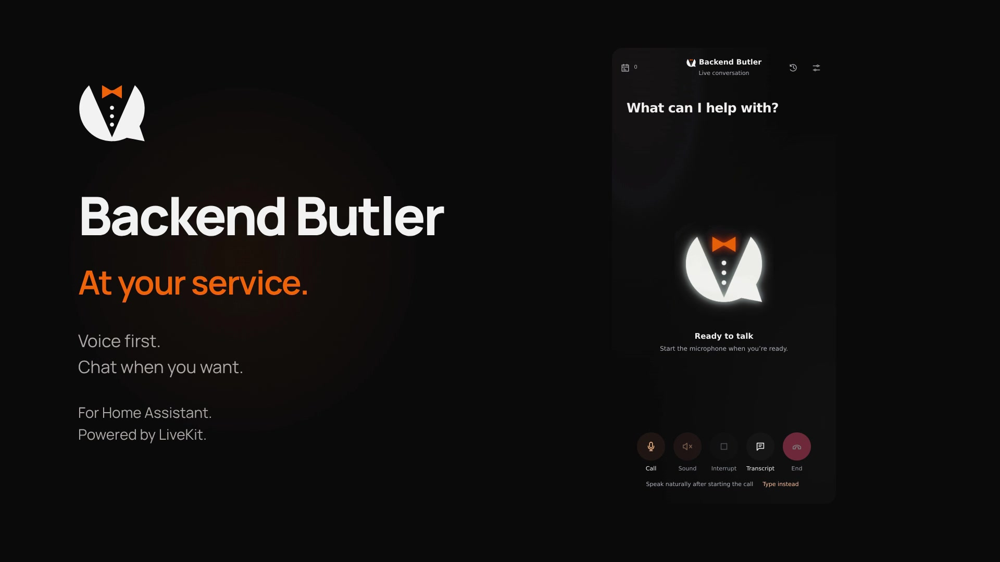

<p align="center">
  
</p>

<h1 align="center">Backend Butler</h1>
<p align="center"><strong>Your home. Your approval.</strong></p>
<p align="center">Voice first. Chat when you want. For Home Assistant. Powered by LiveKit.</p>

<p align="center">
  <a href="#quickstart">Get started</a> ·
  <a href="docs/home-assistant.md">Home Assistant setup</a> ·
  <a href="docs/public-beta.md">Beta notes</a> ·
  <a href="CONTRIBUTING.md">Contribute</a>
</p>

[](https://github.com/taylorsegell/backend-butler/actions/workflows/ci.yml)

**Public beta:** Home Assistant Companion can use its native microphone over local HTTP when the [native bridge](docs/native-audio.md) is enabled on both HA and the matching Butler worker. The same Butler UI and saved history are retained. Ordinary browsers still require HTTPS (or localhost) for voice; typed chat works over HTTP. Home Assistant **2026.11.1 or newer** is required for this beta.

## See Butler in action

[](media/backend-butler-promo.mp4)

[Watch or download the promo · MP4, 24 seconds](media/backend-butler-promo.mp4) · [Music and media credits](media/README.md)

The demo shows a spoken request, Butler’s spoken reply, and a follow-up in one live conversation. Animated audio bars and speaking labels identify each turn; the mobile wireframe illustrates fictional requests and responses.

## Talk to the house

“Which lights are on?” “Turn off the kitchen lights.” “Remind me in twenty minutes.”

Butler puts voice and chat inside Home Assistant. Speak naturally, follow the live captions, and keep the conversation going in text. LiveKit handles the realtime connection; Home Assistant provides the tools for your home.

- **Start with your voice.** Choose continuous listening or manual push-to-talk. Follow live captions and control spoken replies from the card.
- **Pick up in chat.** Type a follow-up, use dictation, or return to saved conversations. Voice and text share the same conversation history.
- **Keep the useful bits close.** Device controls, schedules, people and appearance settings live alongside the conversation.
- **Review bigger changes.** With the optional Butler HA app and MCP bridge, automation/configuration requests can show a preview with Approve and Deny controls. Ordinary device controls follow the tools and permissions you configure.

## What runs where

| Piece | What it does |
| --- | --- |
| Home Assistant integration + dashboard card | The place you talk, type, read replies and manage controls. |
| LiveKit worker | Speech, model responses and Home Assistant MCP tools. Runs alongside your HA host. |
| Scheduler | Saved tasks, people and notifications. Runs with the worker through Docker Compose. |
| Optional Butler HA app | Agent SDK workspace for larger configuration tasks and approval previews. Installed separately. |

Source for the four applications lives under `apps/`. See the [component and storage map](docs/architecture.md) for development paths and upgrade notes.

**Public beta:** bring your own Home Assistant and LiveKit credentials. Inference can incur charges. Saved-session APIs are still evolving, so back up your state before upgrading. See the [beta guide](docs/public-beta.md) for the remaining release checks and limitations.

## Before you start

You need four things in place.

- Home Assistant with the **MCP Server** integration enabled, and a long-lived access token.
- A LiveKit server (self-hosted or LiveKit Cloud) for the realtime transport.
- LiveKit Inference credentials for speech-to-text, the model, and text-to-speech (LiveKit Cloud).
- [HACS](https://hacs.xyz/), to install the integration and card from this repo.

## Quickstart

1. Copy `.env.example` to `.env` and fill in Home Assistant, LiveKit and LiveKit Inference.
2. Generate two secrets with `openssl rand -hex 32` and set them as `SCHEDULER_TOKEN` and `TEXT_API_TOKEN`. The scheduler refuses every request without its token.
3. Start the worker and the scheduler with `docker compose up -d --build`. The worker's HTTP app is on port 8952 and the scheduler's on 8951.
4. In HACS, add this repository as a custom repository of type **Integration**, install **Backend Butler**, and restart Home Assistant.
5. Add the integration under **Settings → Devices & services**. Give it the same LiveKit project and `AGENT_NAME`, the scheduler at `http://<docker-host>:8951` with `SCHEDULER_TOKEN`, and the agent chat at `http://<docker-host>:8952` with `TEXT_API_TOKEN`.
6. Add the **Backend Butler** card to a dashboard, and in its Settings tab add the people in the house and link their HA logins.

[docs/home-assistant.md](docs/home-assistant.md) covers the integration and card in detail.

<details>
<summary><strong>Worker configuration, MCP servers and voice controls</strong></summary>

## Run the worker

This uses [uv](https://docs.astral.sh/uv/).

```bash
cd apps/voice-worker
cp ../../.env.example ../../.env    # then fill in the values (see below)
uv sync
uv run src/main.py dev        # or `console` to test in the terminal
```

Docker Compose builds and runs the same worker:

```bash
docker compose up --build
```

### Environment (`.env` in the repo root)

The agent calls `load_dotenv()`, which walks up until it finds the repo-root `.env`.

| Variable | Purpose |
| --- | --- |
| `HA_URL` | Home Assistant base URL. `/api/mcp` is appended automatically. |
| `HA_TOKEN` | Home Assistant long-lived access token (sent as a bearer token). |
| `HA_HIDDEN_TOOLS` | Comma-separated HA MCP tools to hide from the LLM, such as intents for devices the home lacks. Defaults to `GetDateTime,HassBroadcast,HassCancelAllTimers`. |
| `PARALLEL_API_KEY` / `MEM0_API_KEY` / `HERDR_MCP_URL` | Keys and URLs of the optional MCP servers in `apps/voice-worker/mcp.yaml`; see [MCP servers](#mcp-servers). |
| `CALLBACK_BASE_URL` | This agent's HTTP app as MCP servers reach it, e.g. `http://<agent-host>:8952`, for servers that report long tasks back. |
| `AGENT_PROMPT` / `AGENT_MCP_CONFIG` | Your own copies of `apps/voice-worker/prompt.yaml` and `apps/voice-worker/mcp.yaml` for docker-compose to mount; `apps/voice-worker/*.local.yaml` is git-ignored. |
| `AGENT_NAME` | Explicit-dispatch worker name (default `ha-agent`). Must match the integration's **Agent name**. |
| `STT_IDLE_TIMEOUT` | Seconds after the mic is gated before STT is torn down to save cost (default `120`). |
| `SCHEDULER_TOKEN` | Shared secret for the scheduler's API. Required; the integration sends the same value. |
| `TEXT_API_TOKEN` | Service token for the text chat. Its holder may act for anyone, so only the integration and the scheduler get it. |
| `TEXT_USER_TOKENS` | `name=token,…`: a token per person for their own clients, bound to that person. |
| `LIVEKIT_URL` / `LIVEKIT_API_KEY` / `LIVEKIT_API_SECRET` | Your LiveKit server. |
| `LIVEKIT_INFERENCE_URL` / `LIVEKIT_INFERENCE_API_KEY` / `LIVEKIT_INFERENCE_API_SECRET` | Inference gateway. Falls back to `LIVEKIT_*` if unset. |

Override the models with `STT_MODEL`, `STT_LANGUAGE`, `LLM_MODEL`, `TTS_MODEL`, `TTS_VOICE`, and `TTS_LANGUAGE`. `.env.example` lists every variable, including the advanced ones, with its default.

## MCP servers

Home Assistant's MCP server stays connected. Anything else lives in `apps/voice-worker/mcp.yaml`, and its keys come from `.env` as `${VAR}`, so the yaml file can sit in git. A server whose keys are unset gets skipped, and the agent keeps running on Home Assistant's tools alone. The file that ships lists three:

- **Web search** ([Parallel Search](https://docs.parallel.ai/integrations/mcp/search-mcp)): `web_search` and `web_fetch`. The anonymous free tier works with no key.
- **Memory** ([Mem0](https://docs.mem0.ai/platform/mem0-mcp)): preferences that stick across conversations, kept separate for each person. Needs `MEM0_API_KEY`.
- **Coding agents** ([herdr-mcp-server](https://github.com/taylorsegell/herdr-mcp-server)): start, check, and prompt Claude Code sessions on a computer running herdr, so an "on my computer…" request and its follow-ups stay on one session there. Needs `HERDR_MCP_URL`. It can run code on that computer, so the server is `restricted`. Only people whose Settings entry lists `herdr` under `servers` get it.

A server marked `callback: true` gets this agent's webhook in its `X-Callback-Url` and `X-Callback-Token` headers. When a task outlives its tool call, the server POSTs `{"source", "text"}` to `/chat/events`, and the agent tells the person in their text conversation, with tools off for that turn. That needs `CALLBACK_BASE_URL` and `TEXT_API_TOKEN`. The token a server gets is derived for that one person and reaches only `/chat/events`, so a third-party server never holds the service token. The comments at the top of `mcp.yaml` describe every field. To add a server, add an entry there, or keep your own list in a copy that `AGENT_MCP_CONFIG` points at.

## Who has the mic

The card sets the session while it is running, over RPCs the worker registers.

- **`set_turn_mode`** (`manual` | `auto`). `manual` is push-to-talk. The mic stays gated until `start_turn`, then `end_turn` commits and the agent replies, or `cancel_turn` throws the audio away. `auto` keeps the mic live and lets the model decide when you stopped.
- **`start_turn` / `end_turn` / `cancel_turn`.** The manual turn lifecycle. `start_turn` opens the mic and brings speech-to-text back. `end_turn` and `cancel_turn` gate it, and speech-to-text comes down after the idle timeout. Speech-to-text follows the mic. That is the whole trick.
- **`set_audio_output`** (`on` | `off`). This toggles spoken replies. Off means text only, and off is the default, so text chat runs with speech-to-text and text-to-speech both idle.

The worker broadcasts its live speech-to-text and audio-output state on the `ha.speech_state` data channel so the card can mirror it (a sleeping indicator once speech-to-text is down, for example), and the tool-execution lifecycle on `ha.tool_call`.

Voice sessions close after two minutes without conversation activity by default (`VOICE_IDLE_TIMEOUT`). Speaking, model replies and running tools keep them active; history polling does not. The worker saves the final conversation and releases its lease before disconnecting that session's room. The card releases capture, retains the transcript and reconnects to the selected conversation on your next send or microphone tap. Even an auto-connect card waits for an explicit action after an idle close. Text chat's separate unload timer is unchanged.

Cloud **audio recordings** are off by default, independently of saved conversation history. To enable them for debugging, set `CLOUD_AUDIO_RECORDING_ENABLED=true` and allow recording in the LiveKit project. Other observability categories remain governed by the project setting. Existing uploaded recordings and quota usage are not removed or reset by this policy. See [voice session resource policy](docs/voice-session-policy.md) for behavior and verification.

## Text chat over HTTP

`POST /chat` on port 8952 takes one line of text and answers in plain text. It is one conversation that persists across restarts until you renew it, which is what you want for an iPhone Shortcut. See [docs/text-chat.md](docs/text-chat.md) for the routes, tokens and settings.

</details>

## The dashboard

The integration in `custom_components/backend_butler` is a HACS custom integration and Lovelace card with native device tiles you can tap, plus voice, text chat, a transcript, and tool-call status. It mints LiveKit tokens for logged-in HA users and dispatches this worker by `AGENT_NAME`. Install it as in the [Quickstart](#quickstart); [docs/home-assistant.md](docs/home-assistant.md) has the card options and how to build the card.

The standard integration also packages an opt-in **Companion native microphone**
bridge for local HTTP, keeping Butler's card and saved conversations. See
[native audio setup and candidate validation](docs/native-audio.md). Browser voice
continues using LiveKit RTC. Packaged-path iPhone acceptance is pending.


Install the card, point it at this worker, and talk to the house. Name the room if you want the right light.

### Butler approval requests

With the Butler MCP bridge configured, current Chat and Text views show your Butler requests with Approve/Deny controls, an optional outline, and a YAML or diff preview. Link your Home Assistant login to a person in Settings first. Decisions are bound to that login; bridge credentials stay on the worker. Expired or completed requests cannot be decided again. Voice yes/no decisions still work, and active voice sessions receive Butler updates.

The card refreshes pending state from Butler every three seconds. If Butler cannot be reached, controls are disabled until a successful refresh. Requests belong to your person across current conversations; stored history does not show actionable controls. The worker retains up to 100 request previews per person for one day in `agent-data/approvals.json` (protect it like conversation data).

## Development

Each Python project has its own uv environment and tests:

```bash
(cd apps/voice-worker && uv sync && uv run pytest)
(cd apps/household-service && uv sync && uv run pytest)
(cd apps/dashboard-card && pnpm install && pnpm typecheck && pnpm build)
```

The built card (`custom_components/backend_butler/frontend/backend-butler-card.js`) is committed, because the Home Assistant host has no Node. CI rebuilds it and fails if the committed bundle is stale. It never commits to `main`. See [Contributing](CONTRIBUTING.md) for the complete CI and release gates.

## License

MIT. See [LICENSE](LICENSE).
